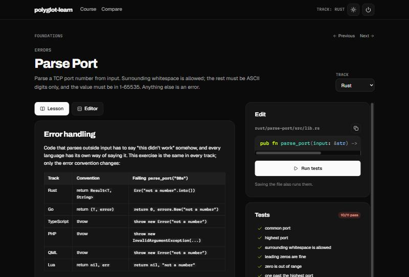

# polyglot-learn

Learn another programming language on your own machine with small, test-driven exercises. It's free, it works offline, and you use your own editor.

Every exercise is written **once** as language-neutral data: a signature plus test cases. Each language track generates its own stub and native tests from that data. You fix a stub, the tests go green, and you move on. Because the exercises are shared, you can also do the same exercise in several languages and compare them.

**Who it's for:** working developers picking up another language. The notes explain each idea relative to a language you already know (TypeScript/JavaScript to start with), instead of from scratch.

**Tracks:** TypeScript (Node), Rust, Go, PHP, Lua 5.4 and QML (Qt 6).

**Modules:** *Foundations* (functions, conditionals, loops, maps, errors, sorting) and *Building Blocks* (structs, interfaces, closures, iterators, modules, concurrency). There are 12 exercises, each available in every track. Then each track has its own *Deeper* module (4 to 6 exercises) for what doesn't exist everywhere: ownership, lifetimes, enums and smart pointers in Rust; embedding, channels, `select` and generics in Go; unions, narrowing and generators in TypeScript; enums, readonly objects and traits in PHP; metatables and coroutines in Lua; bindings, signals and models in QML.

## Quick start

You need the `learn` CLI and a copy of this repository. Each track also needs its own toolchain; `learn doctor` tells you what's missing and how to install it.

**Without Rust:** download `learn` for your system from the [latest release](https://github.com/rg-digital-dev/polyglot-learn/releases/latest) (Linux, macOS and Windows, x86-64 and ARM), unpack it and put `learn` (`learn.exe`) somewhere on your `PATH`. The binaries aren't signed: on macOS, allow it once under System Settings > Privacy & Security; on Windows, choose "More info" > "Run anyway" if SmartScreen asks. Then skip the `cargo install` line below.

**With Rust** 1.88 or newer, build it yourself with `cargo install`:

```bash
git clone https://github.com/rg-digital-dev/polyglot-learn
cd polyglot-learn
cargo install --locked --path runner   # installs the `learn` command
learn init                             # which language do you already know?
learn start rust                       # or typescript, go, php, lua, qml
learn watch                            # edit the file it shows you, then save
```

`learn watch` re-runs the tests each time you save and moves on to the next exercise when they pass. The first Rust check compiles for a few seconds; after that it's quick.

## Web UI

Prefer a browser? Run:

```bash
learn serve --open
```

This opens `http://learn.localhost:4321`. It shows the same course with rendered lessons, a progress grid, test cases turning green or red live as they run, hints, a side-by-side compare view, and an optional in-page editor. You can keep coding in your own editor: the page re-runs the tests when you save.



- **It only runs while the command runs.** Ctrl+C or the Quit button stops it, and no daemon or background process is left behind.
- **It only listens on `127.0.0.1`,** because it runs code. Requests for any other host name are refused.
- **It gives the same results as `learn check`,** because both use the same code.
- **The in-page editor never overwrites a newer file.** If the file changed on disk since you opened it, the page asks before reloading or overwriting.

## Commands

| Command | What it does |
|---|---|
| `learn` / `learn show [slug]` | The current exercise: summary, file to edit, lesson, track note, links |
| `learn check [slug] [-v]` | Run the tests; mark the exercise done when they pass |
| `learn watch` | Re-run on save, advance automatically |
| `learn hint [slug]` | Reveal the next hint |
| `learn status` | Progress table, with exercises as rows and tracks as columns |
| `learn compare <concept>` | One concept's note from every track, one after another |
| `learn docs [concept] [--open]` | Official docs, *lings and Exercism links for a concept |
| `learn start <lang>` | Switch track (your work on other tracks is kept) |
| `learn init` | Change the language your notes compare against |
| `learn doctor` | Which toolchains are installed, with install hints for your OS |
| `learn generate [--lang <id\|all>]` | Regenerate tests after a spec changes; never overwrites your stubs |
| `learn serve [--port N] [--open]` | The web UI at `http://learn.localhost:4321`, until you stop it |
| `learn check-links` | Report dead links in `tracks/*/track.toml` |

`learn` works from any subfolder of the repo.

## Keeping your own solutions

Your solutions and progress are **never** part of this repo: `workspace/` and `.learn/` are gitignored. There are two ways to keep them:

- **Separate folder (recommended).** Keep your solutions in their own folder, and their own git repo if you like:
  ```bash
  learn --workspace ~/code/my-solutions start go
  ```
  You can also set `LEARN_WORKSPACE=~/code/my-solutions`. Progress is saved in that folder too, and `learn` works when run from inside it.
- **Fork.** Fork this repo and work in `workspace/` as usual. Pull new exercises from upstream with `git pull upstream main`.

## How it works

```
course.toml            modules -> ordered exercise slugs
specs/<slug>.json      language-neutral exercise: signature + test cases
concepts/<concept>.md  the lesson, written once
tracks/<lang>/         README, track.toml (links, install hints), one note per concept
tracks/<lang>/extras/  track-only exercises, written natively (lesson, stub, tests)
runner/                the `learn` CLI (Rust): one backend per language
workspace/<lang>/      generated: your stubs + generated tests (gitignored)
```

A backend maps the small spec type vocabulary (`int`, `bool`, `string`, `list<T>`, `map<string,T>`, plus records, classes, interfaces and function types) to native types, renders typed literals, writes the stub and the tests, and reads per-case results back from the test output. Errors follow each language's own convention: `Result` in Rust, `(T, error)` in Go, exceptions in TypeScript, PHP and QML, and `nil, err` in Lua.

Track-only exercises skip the generation step: their stub and tests are written by hand in the language itself, and `learn` copies them into the workspace and runs them with the same test command as the generated ones.

The design borrows from [Exercism's problem-specifications](https://github.com/exercism/problem-specifications) (exercises as data, generated per-language tests) and from [Rustlings](https://github.com/rust-lang/rustlings) (fix one small file at a time, with a watcher). The exercises and text here are original.

## Adding an exercise

Add `specs/<slug>.json` and list the slug in `course.toml`. Every track now has the exercise; run `learn generate --lang all`. Track notes for a new concept are optional. For a feature only one language has, write a track-only exercise in `tracks/<lang>/extras/<slug>/` instead. See [CONTRIBUTING.md](CONTRIBUTING.md).

## Adding a language

Write one backend module in `runner/src/backends/` and a `tracks/<lang>/` folder. [CONTRIBUTING.md](CONTRIBUTING.md) has a checklist.

## Licence

- **Code** (`runner/`, specs, generated harnesses): [MIT](LICENSE).
- **Lesson text** (`concepts/`, `tracks/**/*.md`): [CC BY-SA 4.0](LICENSE-CONTENT.md). You may reuse and adapt it, including commercially, as long as you credit the source and share your changes under the same licence.

The split keeps the code easy to embed anywhere, while improvements to the lessons stay open.

The web UI bundles the fonts Archivo, Geist and Martian Mono under the [SIL Open Font License 1.1](runner/web/app/assets/brand/fonts/) (licence files included). Its visual style uses RG Digital's design tokens.

---

Built by [RG Digital](https://rg-digital.dev).
